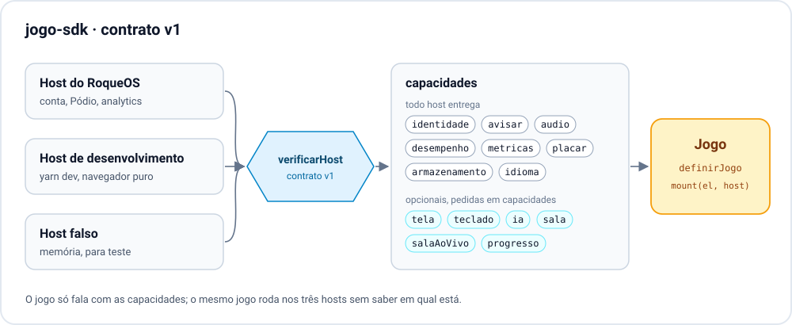

# jogo-sdk

_English | [Português](README.pt-BR.md)_

The contract between [RoqueOS](https://roqueos.com.br) and a game. A game exports `mount(el, host)`; the `host` provides capabilities (who the player is, where to keep the high score, whether the device wants the low-end profile, how to show a notice on screen) and that is the only way the game talks to the system. The same game runs inside RoqueOS, alone in the browser and in tests, without knowing which of the three it is in.



## Why it exists

The RoqueOS games used to live inside the operating system's repository and import its stores directly. On 25/09/2026 they started moving out, each to its own repo in the [roqueos-games](https://github.com/roqueos-games) organization, and several are open to the community. This SDK is what makes that possible: the game depends on it, and not on RoqueOS, which is closed.

## Getting started

You need Node 24 (from `.nvmrc`; 22 at least) and Yarn 1.22.

```bash
git clone https://github.com/roqueos-games/jogo-sdk.git
cd jogo-sdk
yarn install --frozen-lockfile --ignore-scripts
yarn verificar
node bin/jogo.mjs check test/fixtures/jogo-ok
```

`yarn verificar` is everything CI runs: lint, format, the tests and the SDK's own `jogo check`. The last line checks the sample game and ends in `ok, o repo cumpre o contrato.` The step by step, with what each command shows, is in [docs/GETTING-STARTED.md](docs/GETTING-STARTED.md).

In a game repo, the SDK enters as a git dependency pinned by tag:

```json
{ "dependencies": { "@roqueos-games/jogo-sdk": "github:roqueos-games/jogo-sdk#v0.7.0" } }
```

```js
import { definirJogo } from '@roqueos-games/jogo-sdk'

export default definirJogo({
  id: 'exemplo',
  montar(el, host, { ativo }) {
    const canvas = el.appendChild(document.createElement('canvas'))
    host.metricas.evento('abriu')
    return {
      ativar(sim) {},
      desmontar() {
        canvas.remove()
      },
    }
  },
})
```

## The parts

| Part                                                                 | What it is                                                                                                                                                                                                                                                                        |
| -------------------------------------------------------------------- | --------------------------------------------------------------------------------------------------------------------------------------------------------------------------------------------------------------------------------------------------------------------------------- |
| [`src/contrato.js`](src/contrato.js)                                 | the capabilities, the contract version and `verificarHost`; each capability carries its reason, which is part of the contract                                                                                                                                                     |
| `definirJogo` ([`src/index.js`](src/index.js))                       | creates the game; `mount` checks the host before mounting and refuses, with the list of what is missing, a host that does not comply                                                                                                                                              |
| `criarHostDeDesenvolvimento({ jogoId })`                             | runs the game alone, with `localStorage` instead of the account and without AI, on purpose; online rooms play between two tabs                                                                                                                                                    |
| `criarHostFalso()`                                                   | the test host: records every call in `host.chamadas` and simulates what comes from outside with `host.disparar(...)`                                                                                                                                                              |
| `jogo check`                                                         | checks a game repo: `jogo.json`, texts in the ten languages, asset provenance and SHA-256, the download ceiling per profile (30 MB outside `alto/`, 120 MB total), Fab and Sonniss assets only encrypted and only in a closed game, no install scripts, and no Firebase in `src/` |
| `jogo assets importar`, `jogo olho`                                  | third-party model to compressed GLB with the original pinned; screenshots and frame timing on desktop, phone and TV                                                                                                                                                               |
| `./modelos`, `./grafico`, `./painel`, `./som`, `./carga`, `./pacote` | the kits every game shares: 3D models, graphics presets, settings panel, spatial sound, measured loading, encrypted pack                                                                                                                                                          |

Mandatory capabilities: `identidade`, `avisar`, `audio`, `desempenho`, `metricas`, `placar`, `armazenamento` and `idioma`. Optional, requested by the game: `tela`, `teclado`, `ia`, `sala`, `salaAoVivo`, `progresso`, `retomada` and `presenca`. How to use each one, with code, is in [docs/INTEGRATIONS.md](docs/INTEGRATIONS.md).

## Status and limits

Version 0.7.0, contract version 1 ([CHANGELOG.md](CHANGELOG.md), in Portuguese). Changing the shape of a capability is a new contract version; a new optional capability is a minor version. The host refuses a game on another version instead of breaking at runtime. The only exception so far is `ia` in 0.3.0, with the reason and the measurement in the changelog.

The SDK organizes, it does not isolate: a game runs on the same origin as RoqueOS. The security of an open game comes from review at merge and from the exact version pin, described in [SECURITY.md](SECURITY.md) and [docs/THREAT-MODEL.md](docs/THREAT-MODEL.md). The development host does not emulate the database rules. The real host lives in `roqueos-front`, which is closed, and nothing in this repo proves its conformance. The full list is in [docs/ARCHITECTURE.md](docs/ARCHITECTURE.md#9-known-limits).

## Where it fits in the family

RoqueOS (`roqueos-front`, closed) implements the real host and installs each game as a dependency. The games, in [roqueos-games](https://github.com/roqueos-games), depend only on this SDK.

## Documentation

Everything starts at [docs/INDEX.md](docs/INDEX.md).

| Question                                      | Document                                           |
| --------------------------------------------- | -------------------------------------------------- |
| From zero to the first result                 | [docs/GETTING-STARTED.md](docs/GETTING-STARTED.md) |
| How it is built, the decisions and the limits | [docs/ARCHITECTURE.md](docs/ARCHITECTURE.md)       |
| Using each capability and kit                 | [docs/INTEGRATIONS.md](docs/INTEGRATIONS.md)       |
| Every command, entry point, key and format    | [docs/REFERENCE.md](docs/REFERENCE.md)             |
| Maintaining and releasing                     | [docs/OPERATIONS.md](docs/OPERATIONS.md)           |
| When something fails                          | [docs/WHEN-IT-BREAKS.md](docs/WHEN-IT-BREAKS.md)   |
| Adding a capability, a rule or a command      | [docs/EXTENDING.md](docs/EXTENDING.md)             |
| What the tests prove                          | [docs/TESTING.md](docs/TESTING.md)                 |
| What it protects and what it does not         | [docs/THREAT-MODEL.md](docs/THREAT-MODEL.md)       |
| The terms                                     | [docs/GLOSSARY.md](docs/GLOSSARY.md)               |

## Contributing

See [CONTRIBUTING.md](CONTRIBUTING.md). The code, the comments and the commit messages are in Brazilian Portuguese, the project's canonical language; issues and pull requests in English are welcome. Licensed under [MIT](LICENSE).
