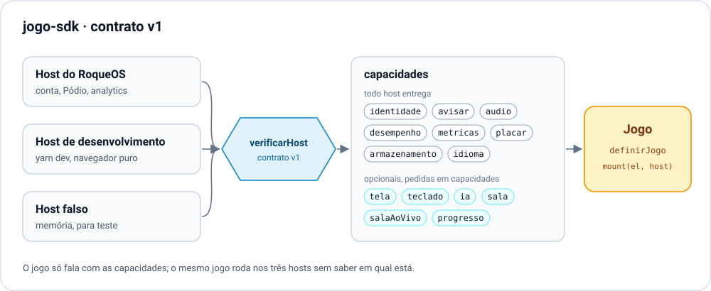
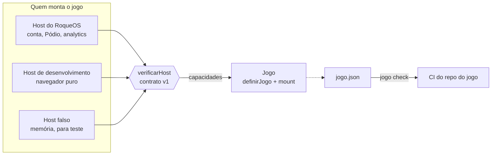

# jogo-sdk

O contrato entre o [RoqueOS](https://roqueos.com.br) e um jogo. Um jogo exporta
`mount(el, host)`; o `host` entrega capacidades (quem é o jogador, onde guardar o recorde,
se o aparelho é fraco, como avisar alguma coisa na tela) e é só por elas que o jogo fala com
o sistema. O mesmo jogo roda dentro do RoqueOS, sozinho no navegador e no teste, sem saber
em qual dos três está.



_English below._

## Por que existe

Os jogos do RoqueOS moravam dentro do repositório do sistema operacional e importavam as
stores dele direto. Em 25/09/2026 eles começaram a sair, cada um para um repo próprio na
organização [roqueos-games](https://github.com/roqueos-games), e vários vão ficar abertos
para a comunidade. Este SDK é o que torna isso possível: o jogo depende dele, e não do
RoqueOS, que é fechado.

## Arquitetura

### Mundo público com combate (0.8.0)

`host.mundo` é opcional e separado de `presenca` e `salaAoVivo`, que preservam as formas
anteriores. Não cria salas privadas: o servidor mantém os mesmos monstros, chefes e horários
para todos na região. O jogo chama `configurar(ficha)` antes de `entrar({mapa,pose,aparencia})`;
a entrada só conclui depois do primeiro snapshot autoritativo. `acao(intent)` envia intenção,
sem dano/HP/UID calculados pelo cliente; quem atribui o cursor monotônico e autentica é o host.
`observarEstado(fn)` entrega `{v:1,mapa,revisao,tempo,mobs,eu,eventos,recompensas}` ou erro
explícito. Os horários são epochms; `eu.prog` já inclui XP concedida. O cliente aplica cada
concessão uma vez, salva seu identificador junto ao progresso e só depois chama
`confirmarRecompensa(id)`. Cair não autoriza combate/ganhos solo como se fossem online.

A ficha `{heroiId,classId,prog,equipment,pocoes?}` tem até 3800 bytes e contém apenas o
necessário para o servidor validar/importar o herói e derivar atributos. As funções puras em
`@roqueos-games/jogo-sdk/mundo` conferem os formatos de transporte; não substituem validação de
equipamento, alcance, recarga, recurso e dano no servidor. O host autentica primeiro e envia a
ficha em um segundo quadro, mantendo a credencial fora de URL e do jogo. Os hosts locais não
anunciam um mundo autoritativo que não possuem; podem omitir a capacidade. Jogos antigos e
hosts que só implementam presença continuam válidos no contrato v1.



- `definirJogo({ id, capacidades, montar })` cria o jogo. `mount` confere o host antes de
  montar e recusa, com a lista do que falta, o host que não cumpre o contrato.
- `verificarHost(host)` diz o que falta num host: capacidade ausente, forma errada, versão de
  contrato diferente. Todos os problemas de uma vez.
- `criarHostDeDesenvolvimento({ jogoId })` roda o jogo sozinho, com `localStorage` no lugar da
  conta e sem IA, de propósito.
- `criarHostFalso()` anota cada chamada em `host.chamadas` e simula mudança vinda de fora com
  `host.disparar('identidade', { uid })`.
- `jogo check` confere um repo de jogo: o `jogo.json`, os textos nos dez idiomas, a origem de
  cada asset (e o SHA-256 dele, quando o ASSETS.md traz), o teto por perfil (30 MB fora de
  `alto/`, 120 MB no total), o asset do Fab e do Sonniss só cifrado (`.pak`, ver `pacote`) e só em jogo fechado, a ausência de script
  que rode sozinho no install e a ausência do Firebase no `src/` (o jogo não fala com banco;
  quem fala é o host).

### Modelo 3D de mercado: o kit de modelos (desde 0.4.0)

Os jogos trocam o desenho feito na hora por modelo de mercado (Poly Haven, Kenney, Quaternius,
Sketchfab, Mixamo, Fab), do mesmo jeito em todos:

1. `assets/importar.json` lista cada modelo com saída, licença, origem e fonte.
   `jogo assets importar` gera o GLB comprimido, fixa o original em `assets/source-lock.json` e
   escreve a linha do ASSETS.md com o SHA-256. O jogo instala as ferramentas em devDependencies:
   `@gltf-transform/core`, `extensions` e `functions` 4.5.1, `meshoptimizer` 1.1.1 e `sharp`
   0.35.4. FBX, OBJ e `.blend` pedem o Blender. Jogo que roda no iPhone usa `"texturasFora": true`: sai `.gltf`,
   `.bin` e cada textura WebP ao lado, porque o WKWebView não mostra textura embutida no GLB.
2. No jogo, `@roqueos-games/jogo-sdk/modelos` carrega e acende:

```js
import * as THREE from 'three'
import { GLTFLoader } from 'three/examples/jsm/loaders/GLTFLoader.js'
import { MeshoptDecoder } from 'three/examples/jsm/libs/meshopt_decoder.module.js'
import { RoomEnvironment } from 'three/examples/jsm/environments/RoomEnvironment.js'
import {
  perfilDoJogo,
  prepararRenderizador,
  acenderAmbiente,
  criarCarregador,
} from '@roqueos-games/jogo-sdk/modelos'

const perfil = perfilDoJogo(host)
prepararRenderizador({ THREE, renderer, perfil })
acenderAmbiente({ THREE, renderer, scene, RoomEnvironment })
const modelos = criarCarregador({ GLTFLoader, MeshoptDecoder, base: '/games/farol/', perfil })
const { cena } = await modelos.modelo({
  baixo: 'modelos/carro.glb',
  alto: 'modelos/alto/carro.glb',
})
```

Para o cenário inteiro de uma vez, `criarCenario` junta modelos, texturas PBR (`cor`, `normal`
e `arm` em `texturas/<id>/`, como o importador escreve) e o céu HDR. O que não chegar fica em
`faltaram` e o jogo segue com o desenho de antes:

```js
const cenario = criarCenario({ THREE, GLTFLoader, MeshoptDecoder, RGBELoader, base, perfil })
await cenario.carregar({ modelos: { banco: 'modelos/banco.gltf' }, texturas: ['piso'], ceu })
cenario.vestir(chao.material, 'piso', 6, 4) // repetição própria, sem vazar para outro material
cena.add(cenario.modelo('banco', 0.75)) // 75 cm de altura, pé no chão, centrado
cenario.aplicarCeu(renderer, cena, { fundo: true })
```

Gráfico e menu de configurações, iguais em todos os jogos:

```js
import {
  configuracaoPadrao,
  carregarConfiguracao,
  salvarConfiguracao,
  criarPosProcesso,
} from '@roqueos-games/jogo-sdk/grafico'
import { abrirPainel } from '@roqueos-games/jogo-sdk/painel'

let cfg = carregarConfiguracao(
  host.armazenamento,
  configuracaoPadrao({ modoLeve, toque }, { fov: 50 }),
)
const pos = criarPosProcesso({ THREE, renderer, scene, camera, cfg, modulos }) // passes do three do jogo
abrirPainel({
  raiz,
  idioma,
  cfg,
  aoMudarGrafico: (c) => {
    pos.aplicar(c)
    salvarConfiguracao(host.armazenamento, c)
  },
})
```

3. O que só o desktop carrega mora numa pasta `alto/`: é ela que fica fora dos 30 MB do perfil
   baixo. O asset do Fab nunca vai cru para `public/`: o EULA manda impedir a extração.
4. `jogo olho antes` e `jogo olho depois` fotografam o mesmo roteiro em desktop, celular e TV e
   medem o quadro. O roteiro do jogo mora em `olho/roteiro.mjs`; o jogo instala o `playwright`
   1.60.0 em devDependencies. O quadro é do navegador sem janela desta máquina, com o
   renderizador gravado ao lado; iPhone de verdade continua sendo o iPhone.

As capacidades, com o motivo de cada uma, estão em [`src/contrato.js`](src/contrato.js). O
motivo é parte do contrato: capacidade sem motivo vira atalho para o jogo alcançar o que não
devia.

- Obrigatórias, que todo host entrega: `identidade`, `avisar`, `audio`, `desempenho`,
  `metricas`, `placar`, `armazenamento` e `idioma`.
- Opcionais, que o jogo pede em `capacidades` quando não vive sem elas: `tela`, `teclado`, `ia`,
  `sala`, `salaAoVivo`, `progresso`, `retomada` e `presenca`.
- `avisar(mensagem, { tipo, fixo })`: `fixo: true` fica na tela até o jogador fechar, para o
  aviso que não pode sumir sozinho ("não consegui ler o seu mundo; nada foi gravado por cima").
- `ia` é `{ completar, disponivel }` desde a 0.3.0: `disponivel()` diz antes da pergunta se há
  modelo, e `completar({ sistema, mensagens: [{ papel: 'jogador' | 'modelo', texto }] })`
  devolve texto ou `null`. O host de desenvolvimento não tem `ia`, de propósito; no teste,
  `criarHostFalso({ ia: async (pedido) => 'resposta', iaDisponivel: true })`.

### Som e tela de entrada: `./som` e `./carga` (desde 0.5.0)

A régua que a Sinuca firmou para todos os jogos: som gravado em alta definição desde a primeira
jogada, no espaço, e uma tela de entrada que mede a carga de verdade.

```js
import { criarAudio } from '@roqueos-games/jogo-sdk/som'
import { criarCarga } from '@roqueos-games/jogo-sdk/carga'
import { carregarPacote } from '@roqueos-games/jogo-sdk/pacote'

const audio = criarAudio(host.audio, {
  pacote: () => carregarPacote(`${BASE}sons.pak`, CHAVE), // gravações cifradas
  espaco: { refDistance: 1.2, rolloffFactor: 1.1, maxDistance: 40 }, // na unidade da cena
})
const carga = criarCarga({ manager: THREE.DefaultLoadingManager })
carga.etapa('mesa', mesaPronta)
carga.etapa('sons', audio.preparar()) // a primeira jogada já sai gravada
carga.aoMudar(({ progresso, etapa }) => desenharEntrada(progresso, etapa))

audio.tocar(audio.variacao('peca', 6), { pos: { x, y, z }, taxa: audio.tom() }) || audio.blip(360)
audio.laco('fogo.mp3', true, { lugares: [{ x: 0, y: 8, z: -40 }] }) // ambiente em laço, no espaço
audio.ouvir({ pos, frente, cima }) // a câmera, a cada quadro

const motor = audio.voz('motor.wav') // voz contínua que o jogo dirige a cada quadro
motor.definir({ taxa: 0.7 + rotacao * 0.9, ganho: 0.8 }) // desliza, sem estalo
motor.parar() // fade e solta os nós
```

Cada golpe sai do grafo de áudio quando acaba (o panner HRTF é o nó mais caro). Sem pacote ou sem
contexto, `tocar` devolve false e o jogo toca a síntese de reserva (`blip`).

### Modelos com dependências completas (0.7.2)

O GLTFLoader pode cumprir `loadAsync` mesmo se uma textura interna falhar. O modo opcional
`criarCenario({ THREE, GLTFLoader, ..., estrito: true })` detecta esse erro com um
LoadingManager privado por modelo e registra o id em `faltaram`. O produtor precisa rejeitar
sua etapa quando `faltaram.length` for diferente de zero; o cenário não muda automaticamente
para um erro de UI.

Quem usa `criarCarregador` diretamente entrega também `LoadingManager: THREE.LoadingManager` e
`estrito: true`. `modelo`/`preparar` rejeitam com `codigo: 'MODELO_INCOMPLETO'`, sem URL ou causa
original no erro. A falha é retirada do cache para permitir nova tentativa; modelos concorrentes
não compartilham o sinal de erro. Um manager externo pode resolver URLs; o modo estrito não
modifica seus callbacks nem os do DefaultLoadingManager. Progresso global de arquivos não é
prometido por esse manager privado, e a tarefa do modelo continua sendo a fonte de conclusão.

Sem `estrito: true`, permanece a política anterior. Esse controle confirma o resultado do
loader e de suas dependências; o jogo ainda verifica o conteúdo esperado e prepara o primeiro
quadro completo antes de revelar o canvas. Não prova pixels, desempenho ou GPU física.

### Abandonar um cenário antes de usá-lo (0.7.3)

`criarCenario` oferece `liberar()` opcional, síncrono e idempotente para abandonar uma carga
inválida ou cancelada **antes de transferir seus recursos ao jogo**. Ele libera geometria,
materiais, mapas e HDR já recebidos, deduplicando recursos compartilhados, limpa tabelas/cache
e descarta também chegadas tardias. Não aborta pedidos de rede. Uma chamada `carregar` ainda
pendente rejeita com `codigo: 'CENARIO_ENCERRADO'` ao terminar; suas chegadas não repopulam o cenário.

```js
const cenario = criarCenario({ THREE, GLTFLoader, RGBELoader, base, perfil, estrito: true })
try {
  const { faltaram } = await cenario.carregar(fontes)
  if (!vivo || faltaram.length) throw new Error('Cenário indisponível.')
} catch (erro) {
  cenario.liberar() // antes de modelo/vestir/aplicarCeu transferirem recursos
  throw erro
}
// Só agora transferir os recursos à cena válida do jogo.
```

Após `liberar`, `carregar` rejeita sem baixar; `modelo`, `vestir` e `aplicarCeu` lançam o mesmo
erro seguro. `tem` retorna false, `ceu` fica null e `faltaram` vazio. Para repetir, crie outro cenário.
Sem chamar esse método, a política de `faltaram` e o contrato do host continuam iguais; não há
abandono automático por falha e `criarCarregador.esquecer()` mantém seu comportamento anterior.

**Dono dos recursos:** clones de modelos compartilham geometria, materiais e mapas com os
originais. Depois de adicionar esses clones à cena, vestir materiais ou aplicar o HDR, o jogo
precisa coordenar o descarte de todos os donos. Não chame `cenario.liberar()` depois de uma
transferência bem-sucedida nem o trate como destroy genérico da cena: texturas clonadas por
`vestir` e o ambiente PMREM criado por `aplicarCeu` passam ao jogo e precisam de seu descarte próprio.

### Carga estrita opcional (0.7.1)

O modo padrão acima preserva a política anterior: a etapa termina mesmo se falhar, e o teto
libera a entrada. Para cenas que só podem aparecer completas, use `estrita: true` e encerre
explicitamente o registro com `selar()`:

```js
const carga = criarCarga({ estrita: true, manager: THREE.DefaultLoadingManager, teto: 30000 })
const cenarioPronto = montarCenarioCompleto().then((r) => {
  if (r.faltaram.length) throw new Error('cenário incompleto')
})
carga.etapa('cenario', cenarioPronto)
carga.etapa('quadro', cenarioPronto.then(prepararPrimeiroQuadroCompleto))
// Espera o preparo; falha de áudio continua tolerada. Não torna os modelos opcionais.
carga.etapa('sons', audio.preparar(), { opcional: true, aguardar: true })
carga.aoMudar(({ progresso, etapa, erro }) => desenharEntrada(progresso, etapa, erro?.codigo))
carga.selar()
try {
  await carga.pronto
  revelarCena()
} catch (erro) {
  mostrarFalhaComNovaTentativa(erro.codigo)
}
// Ao desmontar, inclusive enquanto a entrada ainda espera:
// carga.liberar()
```

`montarCenarioCompleto`, `prepararPrimeiroQuadroCompleto` e as funções de UI são do produtor,
não exports deste SDK. A carga estrita espera as promessas; não inspeciona malhas, não compila
shaders e não valida imagens. O produtor rejeita a etapa quando faltar um recurso obrigatório,
inclusive quando um loader devolver `{ faltaram }`, false ou null em vez de lançar. Promessa
cumprida, inclusive sem valor, significa que o produtor confirmou sucesso. O palco permanece
encoberto até o primeiro quadro completo; este helper sozinho não muda o desenho do jogo.

- Registre cada nome uma vez, antes do selo. Nomes são rótulos lógicos ASCII de 1 a 32 caracteres
  (`mesa`, `mapas_pbr`, `primeiro-quadro`), começando por letra, depois letras/números/`_`/`-`.
  Nunca entregue URL, caminho ou credencial como nome. Rótulo inválido é recusado sem ecoar a entrada.
- `selar()` impede qualquer registro posterior, inclusive de opcional. Todas as obrigatórias
  precisam cumprir suas promessas; não existe sucesso antecipado de uma primeira etapa rápida.
  Esquecer o selo leva ao erro de teto. Selar sem obrigatórias confirma explicitamente que não
  há tarefas necessárias; opcionais sem `aguardar` pendentes não impedem esse sucesso.
- Opcionais sem `aguardar` não bloqueiam, não participam da porcentagem e podem falhar depois.
  Suas rejeições são consumidas; o produtor observa a promessa original se quiser diagnosticar
  ou oferecer outra UI. Assets visíveis necessários não podem ser classificados como opcionais.
- Desde 0.7.4, `{ opcional: true, aguardar: true }` espera o settlement: tanto resolver (inclusive
  false) como rejeitar conclui essa etapa. Ela participa do progresso/etapa atual e impede pronto
  antes do preparo terminar. Não exige gravações disponíveis, desbloqueio por gesto ou som audível.
  O teto global já existente conclui com sucesso se o registro foi selado e todas as obrigatórias
  terminaram com sucesso, mesmo com opcionais aguardadas ainda pendentes. Se faltar obrigatória,
  o mesmo teto rejeita com `tempo-esgotado` e nomes das obrigatórias; esquecer o selo continua erro.
  Nenhum prazo por etapa é criado. As opções precisam ser boolean true; `aguardar` sem `opcional`
  não converte falha obrigatória em tolerada. Sem o novo opt-in, os contratos anteriores continuam.
- `pronto` mantém uma única decisão: resolve sem valor em sucesso, rejeita em falha. Uma reação
  interna evita rejeição global não observada, mas `await carga.pronto` continua a rejeitar.
  A falha não é convertida em sucesso pelo helper. Nova tentativa cria outra carga; não reutiliza
  a antiga. A liberação não aborta downloads do produtor: ele cancela/descarta suas tarefas.
- `fechada()` significa estado terminal, inclusive falha/cancelamento. Use `sucesso()` e
  `erro()` ou aguarde `pronto` para decidir a revelação. O estado de `aoMudar` conserva
  `progresso`, `etapa`, `fechada` e acrescenta `sucesso`, `erro`, `selada`. O progresso é
  monotônico e fica abaixo de 1 até sucesso real; o LoadingManager não conclui etapas sozinho.
- Erros têm mensagem genérica, `.codigo` e `.etapas` (nomes lógicos), sem causa original ou URL.
  Códigos: `etapa-falhou`, `tempo-esgotado`, `cancelada`, `registro-fechado`, `etapa-invalida`,
  `etapa-duplicada`. A etapa inválida/duplicada ou registrada após o selo lança na chamada e
  reprova uma carga ainda pendente; uma carga já terminal mantém sua decisão original.
- `liberar()` cancela uma carga pendente, rejeita `pronto` com `cancelada`, restaura callbacks,
  limpa timer e ouvintes, sem notificar a UI já desmontada. Resoluções tardias são ignoradas.

### Partida online: a capacidade `sala` (desde 0.2.0)

Dois jogadores, um tabuleiro: um cria a sala e recebe um código de cinco letras e um link (o
QR), o outro entra pelo código ou pelo link, e os dois trocam o estado em tempo real. O jogo não
fala com banco nenhum; quem guarda a sala é o host, e o estado do tabuleiro é opaco para ele.
Sem conta não há sala.

```js
const { codigo, link } = await host.sala.criar({ estadoInicial, vez: 'brancas' })
const parar = host.sala.observar(codigo, (sala) => desenhar(sala)) // sala ou null
await host.sala.jogar(codigo, { estado, vez: 'pretas' })

const convite = host.sala.conviteRecebido() // aberto pelo link? o código, ou null
const r = await host.sala.entrar(convite) // { ok } ou { erro: 'nao-encontrada' | 'propria' | 'cheia' | 'sem-conta' }
```

A sala chega com `anfitriao`, `nomeDoAnfitriao`, `convidado`, `nomeDoConvidado`, `situacao`
(`esperando`, `jogando`, `encerrada`), `vez`, `estado`, `vencedor` e `anfitriaoSaiu`. O jogo que
usa sala declara `"capacidades": ["sala"]` e `"aceitaConvite": true` no `jogo.json`.

No `yarn dev` do jogo, o host de desenvolvimento joga online entre duas abas do mesmo navegador:
crie a sala numa aba e abra o link (a própria página com `?sala=<código>`) em outra aba nova. Não
duplique a aba, que copia o `sessionStorage` e vira o mesmo jogador. No teste, o host falso faz
o outro jogador com `host.disparar('sala', { acao: 'entrar', codigo, uid: 'bia' })`, e
`criarHostFalso({ convite: 'ABC23' })` abre o jogo como se viesse do link.

### Sala ao vivo: a capacidade `salaAoVivo` (desde 0.3.0)

Vários jogadores no mesmo mundo, em tempo real: presença de cada um, o que só o anfitrião
simula, a fila de intenções dos convidados, os pedaços do mundo que mudaram. É o modelo da
RagnaRoque e do RoqueCraft. O host dá o código, o link do convite e quem é o jogador, e guarda
a sala no nó que é daquele jogo; o jogo lê e escreve caminhos **dentro da sala** (`''` é a sala
inteira), com as operações do Realtime Database. O que cada nó significa é do jogo; quem decide
quem escreve onde é a regra do banco, não o SDK. Sem conta não há sala.

```js
const s = host.salaAoVivo
const { codigo, link, eu } = await s.criar({ meta: { region: 'greenwood' } }) // o host põe host, hostName e createdAt
const r = await s.entrar(s.conviteRecebido()) // { ok, meta, eu } ou { erro: 'nao-encontrada' | 'sem-conta' }

await s.gravar(codigo, `players/${eu.uid}`, { x, y, t: s.horaDoServidor() })
await s.aoCair(codigo, `players/${eu.uid}`, 'apagar') // some quando esta janela cair ou fechar
await s.atualizar(codigo, 'blocks', { '3_-7/1234': 5 }) // a chave pode ser um caminho
const chave = await s.empurrar(codigo, 'hits', { m, d, by: eu.uid })

const parar = s.observar(codigo, 'players', (jogadores) => desenhar(jogadores)) // valor ou null
s.observarFilhos(codigo, 'chat', { adicionado: (k, msg) => mostrar(msg) }, { ultimos: 60 })
s.conectado((online) => aviso(online))
s.sair(codigo) // para os ouvintes desta sala; não escreve nada
```

As garantias, que valem nos três hosts:

- Caminho com `.`, `#`, `$`, `[`, `]`, caractere de controle, `..` ou segmento vazio, e
  `undefined`, função, `NaN` ou `Date` em qualquer ponto do valor: `TypeError` na hora da
  chamada. O banco recusa os dois; pegar no teste é melhor que pegar no jogador.
- Escrita recusada (regra do banco, rede, sala que a janela não criou nem entrou) resolve
  `false`, ou `null` no `empurrar`, e nunca lança. É desse `false` que um compare-and-set
  depende.
- A primeira entrega de `observar`, `observarFilhos` e `conectado` nunca sai dentro da chamada.
- O valor volta como o banco devolve: objeto vazio some, e array é guardado por índice e volta
  array quando as chaves são inteiras e mais da metade dos índices está preenchida.

No `yarn dev`, o host de desenvolvimento joga entre abas do mesmo navegador, como a `sala`:
crie numa aba e abra o link em outra aba nova. A sala mora no `localStorage`, uma chave por
folha (`roqueos:<jogo>:salaAoVivo:<CÓDIGO>/players/aba-X/x`), para duas abas publicando
presença ao mesmo tempo nunca apagarem uma à outra; cada escrita chega inteira à outra aba,
fechar a aba roda o que ela armou com `aoCair`, e `conectado` segue o `navigator.onLine`. Ele
**não emula as regras do banco**, e o `localStorage` (cerca de 5 MB) serve para jogar e testar,
não para semear um mundo grande.

No teste, o host falso faz os outros jogadores e a regra do banco:

```js
const host = criarHostFalso({
  uid: 'ana',
  // o papel da regra do banco: true recusa (recebe { operacao, codigo, caminho, uid, valor })
  recusar: ({ caminho, uid }) => caminho === 'relogio' && uid !== 'ana',
})
host.disparar('salaAoVivo', { acao: 'criar', codigo: 'ABC23', uid: 'bia', meta: { seed: 1 } })
host.disparar('salaAoVivo', {
  acao: 'gravar',
  codigo: 'ABC23',
  uid: 'bia',
  caminho: 'players/bia',
  valor: { x: 1 },
})
host.disparar('salaAoVivo', { acao: 'aoCair', codigo: 'ABC23', uid: 'bia', caminho: 'players/bia' })
host.disparar('salaAoVivo', { acao: 'cair', uid: 'bia' }) // o que a Bia armou some
host.disparar('conexao', false) // esta janela caiu: roda o que o jogo armou com aoCair
host.arvoreDaSala('ABC23') // a sala inteira, sem passar pelo jogo
```

O jogo que usa sala ao vivo declara `"capacidades": ["salaAoVivo"]` e `"aceitaConvite": true`.
As regras de caminho e de valor também saem por `@roqueos-games/jogo-sdk/sala-ao-vivo`, para o
host do RoqueOS recusar o mesmo que os hosts de teste.

### O jogo salvo: a capacidade `progresso` (desde 0.3.0)

Um documento por jogo, na conta do jogador. "Não tem save" e "não consegui ler" são respostas
diferentes, porque confundir as duas grava um mundo vazio por cima de meses de construção.

```js
if (host.progresso.disponivel()) {
  try {
    const save = await host.progresso.carregar() // objeto, ou null se não há save
  } catch (erro) {
    // erro.codigo === 'indisponivel': não grave por cima; avise e deixe tentar de novo
    host.avisar('Não consegui ler o seu mundo; nada foi gravado por cima.', {
      tipo: 'erro',
      fixo: true,
    })
  }
}
await host.progresso.salvar({ heroi, updatedAt: Date.now() }, { mesclar: true }) // true ou false
```

`salvar` substitui o documento; com `mesclar`, funde mapa com mapa, como o `merge` do Firestore.
Os hosts de teste recusam com `false` o que o Firestore recusa: `undefined`, array dentro de
array, objeto que não é mapa simples (e `Date`, que volta do Firestore como Timestamp), campo de
nome vazio ou `__assim__`, e documento acima de 1 MiB. O host de desenvolvimento guarda em
`roqueos:<jogo>:progresso`; no falso, `criarHostFalso({ uid, progresso: { salvo, falharLeitura,
falharEscrita } })` e `host.disparar('progresso', { falharLeitura: false })`. Sem conta,
`disponivel()` é `false`.

## Pré-requisitos

- Node 24 (o `.nvmrc` diz), ou 22 no mínimo.
- Yarn 1.22.

Não há dependência de runtime. As de desenvolvimento são ESLint, Prettier, o three (só para o
teste do kit de modelos) e as ferramentas do importador, para o teste de ponta a ponta dele.

## Como rodar

1. Clone o repo e entre na pasta.
2. Instale sem rodar script de ninguém: `yarn install --ignore-scripts`.
3. Rode tudo o que o CI roda: `yarn verificar` (lint, formato, os testes e o `jogo check` do
   próprio SDK).
4. Para conferir um repo de jogo: `node bin/jogo.mjs check ../caminho-do-jogo`.

### O CLI `jogo`

```
jogo check [pasta] [--sdk] [--json]
jogo assets importar [--apenas=id,id]
jogo olho <rótulo> [--url=http://…] [--roteiro=olho/roteiro.mjs] [--segundos=5]
```

- `--usage`, `--help` ou `-h` em qualquer nível (`jogo --usage`, `jogo assets --usage`,
  `jogo assets importar --usage`) mostram a ajuda daquele nível e saem 0, sem rodar nada e sem
  tocar no disco. A ajuda ganha de qualquer outro argumento da linha.
- Cada comando aceita só as opções que declara em [`src/cli.js`](src/cli.js). Opção desconhecida,
  `--opcao` de valor sem o `=valor`, opção repetida ou argumento solto a mais saem 2 com a
  mensagem de qual foi e o uso, antes de qualquer escrita (desde 0.5.1).
- `jogo assets importar` sem `--apenas` importa a lista inteira de `assets/importar.json` e
  sobrescreve as saídas; é o uso documentado, e só roda depois que o parse validou a linha.
  `--apenas` com um id que não está na lista sai 1 sem escrever.

Num repo de jogo, o SDK entra como dependência git pinada por tag:

```json
{ "dependencies": { "@roqueos-games/jogo-sdk": "github:roqueos-games/jogo-sdk#v0.4.0" } }
```

```js
import { definirJogo } from '@roqueos-games/jogo-sdk'

export default definirJogo({
  id: 'exemplo',
  montar(el, host, { ativo }) {
    const canvas = el.appendChild(document.createElement('canvas'))
    host.metricas.evento('abriu')
    return {
      ativar(sim) {},
      desmontar() {
        canvas.remove()
      },
    }
  },
})
```

## Estrutura

```
src/
  contrato.js         as capacidades, a versão e verificarHost
  index.js            definirJogo e o que o jogo importa
  manifesto.js        o formato do jogo.json e as etiquetas da galeria
  idiomas.js          os dez idiomas
  e2e.js              o modo de teste de ponta a ponta
  verificacao.js      o que o jogo check confere
  modelos.js          o kit de modelos: perfil, renderizador, ambiente, carregador (0.4.0)
  cli.js              as opções de cada comando do CLI e o parse que recusa o resto (0.5.1)
  importador.js       jogo assets importar (0.4.0)
  olho.js             jogo olho (0.4.0)
  host/               desenvolvimento, falso, o espaço de chaves do armazenamento, e o que
                      os dois dividem: as regras da sala, o motor da sala ao vivo
                      (salaAoVivo.js), o progresso e o pedido da ia
bin/jogo.mjs          o CLI
test/                 node:test, com um jogo de exemplo em test/fixtures/jogo-ok; test/mutantes.mjs
                      quebra cada régua do jogo check e confere que a suíte reprova
docs/contrato.svg     o diagrama acima
```

## Onde ele se encaixa na família

O RoqueOS (`roqueos-front`, fechado) implementa o host de verdade e instala cada jogo como
dependência. Os jogos, na organização [roqueos-games](https://github.com/roqueos-games),
dependem só deste SDK. Mudar a forma de uma capacidade é versão nova do contrato; capacidade
nova e opcional é versão menor. O host recusa jogo de outra versão em vez de quebrar em
runtime. A única exceção até hoje é a `ia` na 0.3.0, com o motivo e a medição no
[CHANGELOG](CHANGELOG.md).

O SDK organiza, não isola: um jogo roda na mesma origem do RoqueOS. A segurança de um jogo
aberto vem da revisão no merge e do pin exato de versão, e está descrita em
[SECURITY.md](SECURITY.md).

## Contribuir

Veja [CONTRIBUTING.md](CONTRIBUTING.md). Licença [MIT](LICENSE).

---

## English

Since 0.7.3, `criarCenario().liberar()` explicitly abandons an invalid/cancelled load **before
asset ownership is transferred**. It is synchronous and idempotent, deduplicates shared model
geometry/materials/maps and HDR, clears the cache/tables and disposes late arrivals. It does
not abort network requests. A pending `carregar` rejects with safe code `CENARIO_ENCERRADO`
when it finishes; later calls cannot reuse the closed instance. Create a new scenario to retry.
Without calling this optional method, existing behavior and host contract 1 remain unchanged.
Model clones share resources: never use this method after successful transfer as a generic
scene destroy. The caller must coordinate ownership, including cloned texture maps and PMREM
environments it has already applied.

`jogo-sdk` is the contract between [RoqueOS](https://roqueos.com.br) and a game. A game
exports `mount(el, host)`; the `host` provides capabilities (who the player is, where to keep
the high score, whether the device needs the low-end profile, how to show a notice) and that
is the only way the game talks to the system. The same game runs inside RoqueOS, standalone
in the browser, and in tests.

- `definirJogo({ id, capacidades, montar })` defines a game; `mount` checks the host first.
- `verificarHost(host)` lists every missing or malformed capability.
- `criarHostDeDesenvolvimento({ jogoId })` runs a game on its own, with `localStorage` and no AI.
- `criarHostFalso()` records every call for tests.
- `jogo check` validates a game repo: `jogo.json`, texts in the ten languages, asset
  provenance, no install-time scripts, and no Firebase import under `src/` (the game never
  talks to a database; the host does). Since 0.4.0 it also enforces the download ceiling per
  profile (30 MB outside `alto/`, 120 MB total), keeps Fab assets encrypted and out of open
  repos, and checks the optional SHA-256 column of `ASSETS.md`.
- Since 0.4.0, the model kit: `@roqueos-games/jogo-sdk/modelos` (profile from the host,
  renderer setup with ACES and sRGB, image-based lighting, a cached GLTF loader with meshopt),
  `jogo assets importar` (third-party model to compressed GLB, original pinned by SHA-256) and
  `jogo olho` (screenshots and frame timing on desktop, phone and TV, through the game's own
  script).
- Since 0.5.1 the `jogo` CLI rejects any option a command does not declare (exit 2, before
  touching the disk), and `--usage`, `--help` or `-h` at any level print that level's help and
  exit 0 without running anything.
- Optional capabilities: `tela` (fullscreen), `teclado` (keyboard focus), `ia` (AI completion:
  `disponivel()` says up front whether a model is available, `completar({ sistema, mensagens:
[{ papel, texto }] })` returns text or `null`) and, since 0.2.0, `sala`: a two-player online
  match. One player creates a room and gets a five-letter code and an invite link, the other
  joins, and both exchange the board state. The game never talks to a database, the state is
  opaque to the host, and there is no room without an account. The dev host plays it across two
  tabs of the same browser (`localStorage` plus the `storage` event, no network), and the fake
  host simulates the other player with `host.disparar('sala', { acao, codigo })`.
- Since 0.3.0, `salaAoVivo`: a real-time room for many players (presence, host-only nodes,
  guest intents, chat). The host provides the code, the invite link and the player; the game
  reads and writes paths inside the room with Realtime Database operations (`ler`, `gravar`,
  `atualizar`, `apagar`, `empurrar`, `observar`, `observarFilhos`, `aoCair`). Bad paths and
  `undefined` throw `TypeError` at call time, refused writes resolve `false`, first deliveries
  are always asynchronous, and values come back the way the database returns them. The dev
  host plays it across tabs with one `localStorage` key per leaf; the fake host adds other
  players, a connection drop and a `recusar` option that stands in for the database rules.
- Since 0.3.0, `progresso`: the player's saved game on their account. `carregar()` returns
  `null` when there is no save and rejects with `codigo: 'indisponivel'` when it cannot read;
  `salvar(dados, { mesclar })` never throws. The test hosts refuse what Firestore refuses
  (`undefined`, nested arrays, non-plain objects, documents over 1 MiB).
- `avisar(mensagem, { tipo, fixo })`: `fixo: true` stays on screen until the player closes it.

Requirements: Node 24 (22 minimum) and Yarn 1.22. Run `yarn install --ignore-scripts`, then
`yarn verificar`. The code and comments are in Brazilian Portuguese, which is the canonical
language of the project; issues and pull requests in English are welcome. MIT licensed.
