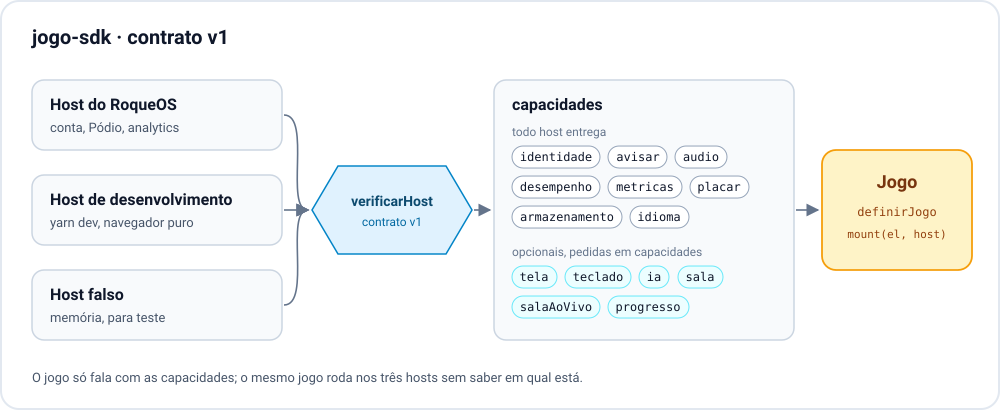

# jogo-sdk

_[English](README.md) | Português_

O contrato entre o [RoqueOS](https://roqueos.com.br) e um jogo. Um jogo exporta `mount(el, host)`; o `host` entrega capacidades (quem é o jogador, onde guardar o recorde, se o aparelho pede o perfil leve, como avisar alguma coisa na tela) e é só por elas que o jogo fala com o sistema. O mesmo jogo roda dentro do RoqueOS, sozinho no navegador e no teste, sem saber em qual dos três está.



## Por que existe

Os jogos do RoqueOS moravam dentro do repositório do sistema operacional e importavam as stores dele direto. Em 25/09/2026 eles começaram a sair, cada um para um repo próprio na organização [roqueos-games](https://github.com/roqueos-games), e vários são abertos para a comunidade. Este SDK é o que torna isso possível: o jogo depende dele, e não do RoqueOS, que é fechado.

## Como começar

Você precisa do Node 24 (do `.nvmrc`; 22 no mínimo) e do Yarn 1.22.

```bash
git clone https://github.com/roqueos-games/jogo-sdk.git
cd jogo-sdk
yarn install --frozen-lockfile --ignore-scripts
yarn verificar
node bin/jogo.mjs check test/fixtures/jogo-ok
```

O `yarn verificar` é tudo o que o CI roda: lint, formato, os testes e o `jogo check` do próprio SDK. A última linha confere o jogo de exemplo e termina em `ok, o repo cumpre o contrato.` O passo a passo, com o que cada comando mostra, está em [docs/pt-BR/COMECAR.md](docs/pt-BR/COMECAR.md).

Num repo de jogo, o SDK entra como dependência git pinada por tag:

```json
{ "dependencies": { "@roqueos-games/jogo-sdk": "github:roqueos-games/jogo-sdk#v0.7.0" } }
```

```js
import { definirJogo } from '@roqueos-games/jogo-sdk'

export default definirJogo({
  id: 'exemplo',
  montar(el, host, { ativo }) {
    const canvas = el.appendChild(document.createElement('canvas'))
    host.metricas.evento('abriu')
    return {
      ativar(sim) {},
      desmontar() {
        canvas.remove()
      },
    }
  },
})
```

## As partes

| Parte                                                                | O que é                                                                                                                                                                                                                                                                                       |
| -------------------------------------------------------------------- | --------------------------------------------------------------------------------------------------------------------------------------------------------------------------------------------------------------------------------------------------------------------------------------------- |
| [`src/contrato.js`](src/contrato.js)                                 | as capacidades, a versão do contrato e o `verificarHost`; cada capacidade traz o motivo, que é parte do contrato                                                                                                                                                                              |
| `definirJogo` ([`src/index.js`](src/index.js))                       | cria o jogo; o `mount` confere o host antes de montar e recusa, com a lista do que falta, o host que não cumpre                                                                                                                                                                               |
| `criarHostDeDesenvolvimento({ jogoId })`                             | roda o jogo sozinho, com `localStorage` no lugar da conta e sem IA, de propósito; as salas online jogam entre duas abas                                                                                                                                                                       |
| `criarHostFalso()`                                                   | o host de teste: anota cada chamada em `host.chamadas` e simula o que vem de fora com `host.disparar(...)`                                                                                                                                                                                    |
| `jogo check`                                                         | confere um repo de jogo: `jogo.json`, os textos nos dez idiomas, a origem e o SHA-256 dos assets, o teto de download por perfil (30 MB fora de `alto/`, 120 MB no total), asset do Fab e do Sonniss só cifrado e só em jogo fechado, nenhum script de instalação, e nenhum Firebase no `src/` |
| `jogo assets importar`, `jogo olho`                                  | modelo de mercado para GLB comprimido com o original fixado; fotos e quadro em desktop, celular e TV                                                                                                                                                                                          |
| `./modelos`, `./grafico`, `./painel`, `./som`, `./carga`, `./pacote` | os kits que todos os jogos dividem: modelos 3D, qualidades de gráfico, painel de configurações, som no espaço, carga medida, pacote cifrado                                                                                                                                                   |

Capacidades obrigatórias: `identidade`, `avisar`, `audio`, `desempenho`, `metricas`, `placar`, `armazenamento` e `idioma`. Opcionais, que o jogo pede: `tela`, `teclado`, `ia`, `sala`, `salaAoVivo`, `progresso`, `retomada` e `presenca`. Como usar cada uma, com código, está em [docs/pt-BR/INTEGRACOES.md](docs/pt-BR/INTEGRACOES.md).

## Estado e limites

Versão 0.7.0, contrato na versão 1 ([CHANGELOG.md](CHANGELOG.md)). Mudar a forma de uma capacidade é versão nova do contrato; capacidade nova e opcional é versão menor. O host recusa jogo de outra versão em vez de quebrar em runtime. A única exceção até hoje é a `ia` na 0.3.0, com o motivo e a medição no changelog.

O SDK organiza, não isola: um jogo roda na mesma origem do RoqueOS. A segurança de um jogo aberto vem da revisão no merge e do pin exato de versão, descrita no [SECURITY.md](SECURITY.md) e no [docs/pt-BR/MODELO-DE-AMEACAS.md](docs/pt-BR/MODELO-DE-AMEACAS.md). O host de desenvolvimento não emula as regras do banco. O host de verdade mora no `roqueos-front`, que é fechado, e nada neste repo prova que ele cumpre o contrato. A lista inteira está em [docs/pt-BR/ARQUITETURA.md](docs/pt-BR/ARQUITETURA.md#9-limites-conhecidos).

## Onde ele se encaixa na família

O RoqueOS (`roqueos-front`, fechado) implementa o host de verdade e instala cada jogo como dependência. Os jogos, na [roqueos-games](https://github.com/roqueos-games), dependem só deste SDK.

## Documentação

Tudo começa em [docs/pt-BR/INDEX.md](docs/pt-BR/INDEX.md).

| Pergunta                                            | Documento                                                          |
| --------------------------------------------------- | ------------------------------------------------------------------ |
| Do zero ao primeiro resultado                       | [docs/pt-BR/COMECAR.md](docs/pt-BR/COMECAR.md)                     |
| Como é por dentro, as decisões e os limites         | [docs/pt-BR/ARQUITETURA.md](docs/pt-BR/ARQUITETURA.md)             |
| Usar cada capacidade e cada kit                     | [docs/pt-BR/INTEGRACOES.md](docs/pt-BR/INTEGRACOES.md)             |
| Todo comando, ponto de entrada, chave e formato     | [docs/pt-BR/REFERENCIA.md](docs/pt-BR/REFERENCIA.md)               |
| Manter e publicar                                   | [docs/pt-BR/OPERACAO.md](docs/pt-BR/OPERACAO.md)                   |
| Quando algo falha                                   | [docs/pt-BR/QUANDO-QUEBRA.md](docs/pt-BR/QUANDO-QUEBRA.md)         |
| Acrescentar uma capacidade, uma régua ou um comando | [docs/pt-BR/ESTENDER.md](docs/pt-BR/ESTENDER.md)                   |
| O que os testes provam                              | [docs/pt-BR/TESTES.md](docs/pt-BR/TESTES.md)                       |
| O que ele protege e o que não protege               | [docs/pt-BR/MODELO-DE-AMEACAS.md](docs/pt-BR/MODELO-DE-AMEACAS.md) |
| Os termos                                           | [docs/pt-BR/GLOSSARIO.md](docs/pt-BR/GLOSSARIO.md)                 |

## Contribuir

Veja [docs/pt-BR/CONTRIBUTING.md](docs/pt-BR/CONTRIBUTING.md). O código, os comentários e as mensagens de commit são em português do Brasil, o idioma canônico do projeto; issue e pull request em inglês são bem-vindos. Licença [MIT](LICENSE).
