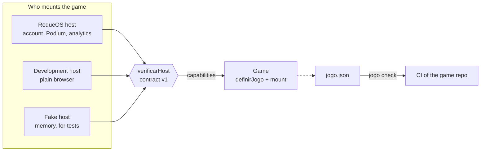
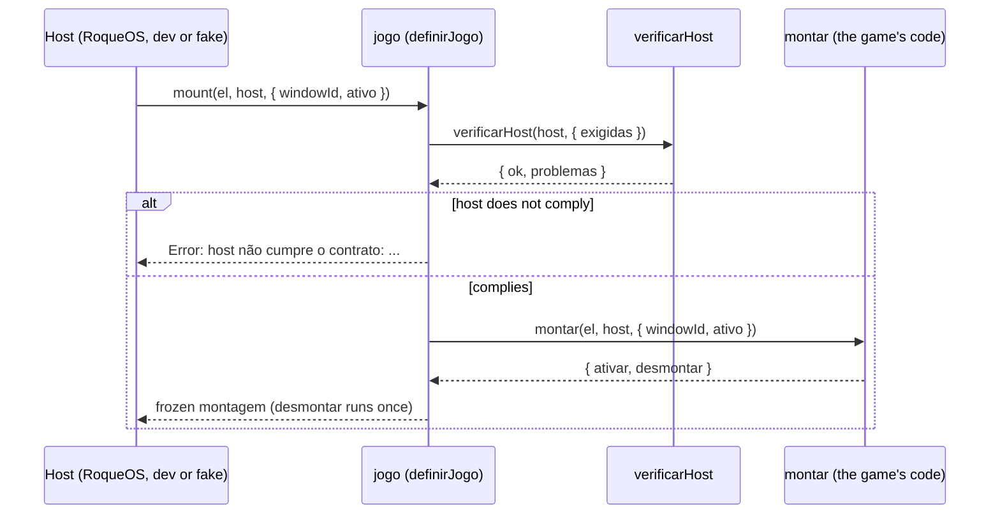
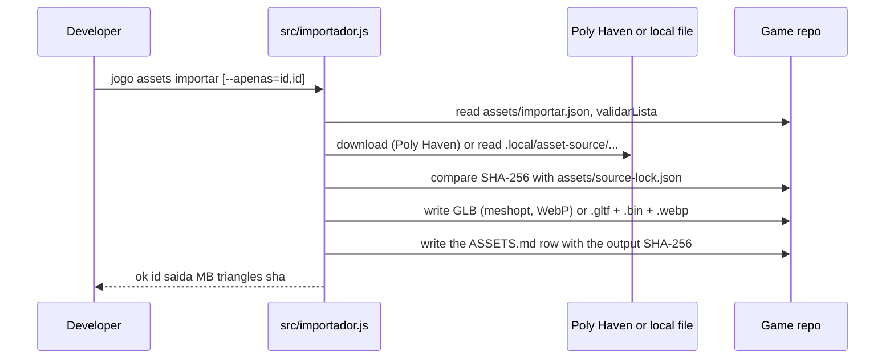
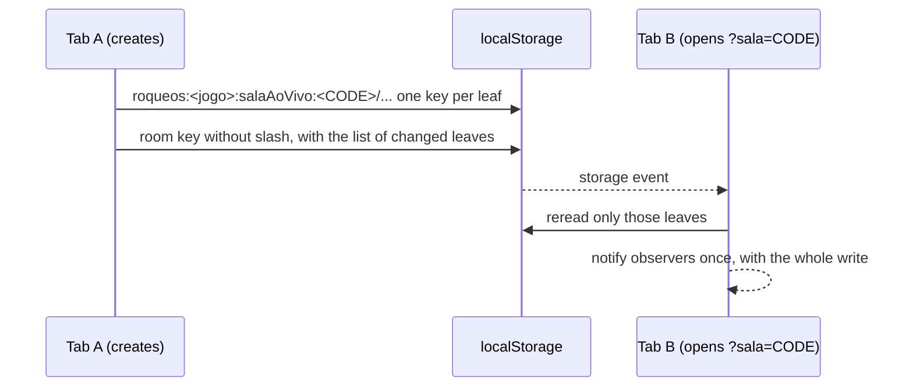

# Architecture

_English | [Português](pt-BR/ARQUITETURA.md)_

> **Who it is for:** whoever is about to change the SDK, implement a host, or port a game and needs to know how the pieces fit before touching them.
> **What is here:** the idea, the context, where the code runs, every component with its file, the main flows in sequence diagrams, the data that crosses a boundary, the design decisions with their dates, and the known limits.
> **Where to go for the rest:** every command, file and format is in [REFERENCE.md](REFERENCE.md); how a game or a host uses each capability, in [INTEGRATIONS.md](INTEGRATIONS.md); what can go wrong, in [WHEN-IT-BREAKS.md](WHEN-IT-BREAKS.md).

## Contents

1. [The idea in one paragraph](#1-the-idea-in-one-paragraph)
2. [Context: who uses it and what it depends on](#2-context-who-uses-it-and-what-it-depends-on)
3. [Processes and where they run](#3-processes-and-where-they-run)
4. [Components](#4-components)
5. [The main flows](#5-the-main-flows)
6. [Data and contracts](#6-data-and-contracts)
7. [Security and secrets](#7-security-and-secrets)
8. [Design decisions](#8-design-decisions)
9. [Known limits](#9-known-limits)
10. [How the diagrams are made](#10-how-the-diagrams-are-made)

## 1. The idea in one paragraph

A game is an object with `mount(el, host)`, built by `definirJogo` ([`src/index.js`](../src/index.js)). The `host` hands it capabilities (who the player is, where to keep the high score, whether the device wants the low-end profile, how to show a notice) and the game talks to the system only through them. Three hosts implement the same contract: the RoqueOS host (which lives in the closed `roqueos-front`, not here), the development host ([`src/host/desenvolvimento.js`](../src/host/desenvolvimento.js)) and the fake host for tests ([`src/host/falso.js`](../src/host/falso.js)). `mount` checks the host against [`src/contrato.js`](../src/contrato.js) before anything runs and refuses, with the full list of what is missing, a host that does not comply. Around that core, the SDK carries the `jogo` CLI that every game repo runs in its CI ([`bin/jogo.mjs`](../bin/jogo.mjs)) and a set of optional kits (3D models, graphics, settings panel, sound, loading, encrypted pack) so that every game in the [roqueos-games](https://github.com/roqueos-games) organization does the same thing the same way.

## 2. Context: who uses it and what it depends on

The games used to live inside the RoqueOS repository and import its stores directly. On 25/09/2026 they started moving out, each to its own repo, and several are open to the community. A game depends on this SDK and not on RoqueOS, which is closed ([README.md](../README.md)).



| Depends on                                                                             | What for                                                                                                                                        | What happens when it is missing                                                                    |
| -------------------------------------------------------------------------------------- | ----------------------------------------------------------------------------------------------------------------------------------------------- | -------------------------------------------------------------------------------------------------- |
| The RoqueOS host, in `roqueos-front` (closed)                                          | the real implementation of every capability: account, Podium, analytics, database                                                               | the game still runs on the development host; nothing in this repo can prove the real host complies |
| Node 22 or newer, Yarn 1.22 ([`package.json`](../package.json), [`.nvmrc`](../.nvmrc)) | the CLI, the tests, the gate                                                                                                                    | `yarn verificar` does not run                                                                      |
| GitHub tags (`vX.Y.Z`)                                                                 | how a game pins the SDK: `github:roqueos-games/jogo-sdk#vX.Y.Z`                                                                                 | the game cannot install a fixed version                                                            |
| The game's own `three`                                                                 | the model, graphics and sound kits receive the three modules from the game; the SDK never imports three ([`src/modelos.js`](../src/modelos.js)) | the kits are not usable; the contract still is                                                     |
| The game's `@gltf-transform/*`, `meshoptimizer` and `sharp`                            | `jogo assets importar` ([`src/importador.js`](../src/importador.js))                                                                            | the command stops with the exact `yarn add -D` line to run                                         |
| The game's `playwright`                                                                | `jogo olho` ([`src/olho.js`](../src/olho.js))                                                                                                   | the command stops with the install line                                                            |
| Blender                                                                                | FBX, OBJ and `.blend` sources in the importer                                                                                                   | `modelo FBX/OBJ/.blend precisa do Blender: instale ou aponte BLENDER=`                             |
| The Poly Haven API                                                                     | the importer's `fonte.polyhaven` sources                                                                                                        | the download fails after three tries; manual files (`fonte.arquivo`) still work                    |

The SDK has no runtime dependency at all ([`CLAUDE.md`](../CLAUDE.md)); everything in `devDependencies` is there for the SDK's own tests.

## 3. Processes and where they run

The SDK is a library and a CLI. It has no server, no daemon and no state of its own.

| What                                             | Where it runs                                                                                                                                                                                               | Who starts it                                  |
| ------------------------------------------------ | ----------------------------------------------------------------------------------------------------------------------------------------------------------------------------------------------------------- | ---------------------------------------------- |
| The library (`definirJogo`, the hosts, the kits) | in the game's page, in the browser; inside RoqueOS on the same origin as the system                                                                                                                         | the game's own bundle                          |
| `jogo check`                                     | Node, in the game repo, on the developer's machine and in the game's CI                                                                                                                                     | `yarn jogo:check` or `node bin/jogo.mjs check` |
| `jogo assets importar`                           | Node, in the game repo, on the developer's machine (it downloads and writes files)                                                                                                                          | the developer, by hand                         |
| `jogo olho`                                      | Node plus a headless Chromium from the game's Playwright; starts the game's `yarn dev` on port 5199 unless `--url` is given                                                                                 | the developer, before and after a change       |
| The SDK's gate                                   | GitHub Actions, workflow `verificar` ([`.github/workflows/ci.yml`](../.github/workflows/ci.yml)), on every push to `main` and every pull request, including forks, with read-only permissions and no secret | GitHub                                         |

## 4. Components

| File                                                            | Responsibility                                                                    | Who depends on it                                                  |
| --------------------------------------------------------------- | --------------------------------------------------------------------------------- | ------------------------------------------------------------------ |
| [`src/contrato.js`](../src/contrato.js)                         | `VERSAO_DO_CONTRATO`, the capabilities with shape and reason, `verificarHost`     | everything; the RoqueOS host                                       |
| [`src/index.js`](../src/index.js)                               | `definirJogo` and `mount`; re-exports what a game imports                         | every game                                                         |
| [`src/manifesto.js`](../src/manifesto.js)                       | the `jogo.json` format, `ETIQUETAS`, `LIMITE_DO_RESUMO`, `validarManifesto`       | `jogo check`; RoqueOS, which builds its catalog from the manifests |
| [`src/idiomas.js`](../src/idiomas.js)                           | the ten languages, `normalizarIdioma`                                             | manifest, texts check, panel                                       |
| [`src/e2e.js`](../src/e2e.js)                                   | `emModoE2E` and `estadoE2E`, read from `window.__ROS_E2E__`                       | games under Playwright or Cypress                                  |
| [`src/verificacao.js`](../src/verificacao.js)                   | every rule of `jogo check`                                                        | the CLI; the mutants                                               |
| [`src/cli.js`](../src/cli.js)                                   | the options each command accepts and the parse that refuses the rest              | [`bin/jogo.mjs`](../bin/jogo.mjs)                                  |
| [`src/importador.js`](../src/importador.js)                     | `jogo assets importar`                                                            | the CLI                                                            |
| [`src/olho.js`](../src/olho.js)                                 | `jogo olho`                                                                       | the CLI                                                            |
| [`src/modelos.js`](../src/modelos.js)                           | profile, renderer, environment, GLTF loader, `criarCenario`                       | 3D games                                                           |
| [`src/grafico.js`](../src/grafico.js)                           | quality presets, effects, FOV, saved choice, post-processing chain                | 3D games                                                           |
| [`src/painel.js`](../src/painel.js)                             | the settings panel (Graphics and Sound) in plain DOM, ten languages               | games                                                              |
| [`src/som.js`](../src/som.js)                                   | recorded sound in space, loops, continuous voices, synthesis fallback             | games                                                              |
| [`src/carga.js`](../src/carga.js)                               | measured loading progress for the entry screen                                    | games                                                              |
| [`src/pacote.js`](../src/pacote.js)                             | the encrypted `.pak` (AES-GCM): seal in Node, open in the browser                 | games with Fab or Sonniss assets                                   |
| [`src/host/desenvolvimento.js`](../src/host/desenvolvimento.js) | the development host                                                              | the game's `yarn dev`                                              |
| [`src/host/falso.js`](../src/host/falso.js)                     | the fake host, with `chamadas`, `disparar` and options for every failure          | the game's tests                                                   |
| [`src/host/armazenamento.js`](../src/host/armazenamento.js)     | the key space `roqueos:<jogo>:<chave>` and an in-memory Storage                   | both hosts                                                         |
| [`src/host/sala.js`](../src/host/sala.js)                       | the seat rules of the two-player room                                             | both hosts                                                         |
| [`src/host/salaAoVivo.js`](../src/host/salaAoVivo.js)           | the live-room engine, plus the path and value rules exported for the RoqueOS host | both hosts; RoqueOS                                                |
| [`src/host/progresso.js`](../src/host/progresso.js)             | the saved game, refusing what Firestore refuses                                   | both hosts                                                         |
| [`src/host/presenca.js`](../src/host/presenca.js)               | presence rules and the in-memory engine                                           | both hosts; RoqueOS                                                |
| [`src/host/ia.js`](../src/host/ia.js)                           | checks the shape of an `ia.completar` request                                     | the fake host                                                      |

## 5. The main flows

### 5.1 Mounting a game



`verificarHost` checks the contract version, every mandatory capability, the optional ones the game listed in `capacidades`, and the shape of every capability present, and returns every problem at once ([`src/contrato.js`](../src/contrato.js)). Unmounting twice is a real case (the window closes and the surrounding component unmounts right after), so the second call does nothing ([`src/index.js`](../src/index.js)).

### 5.2 `jogo check` in a game's CI

```mermaid
sequenceDiagram
  participant CI as Game CI
  participant B as bin/jogo.mjs
  participant P as src/cli.js
  participant V as src/verificacao.js
  CI->>B: jogo check [pasta] [--json]
  B->>P: lerArgumentos(argv)
  P-->>B: { comando, opcoes, posicionais } or { erro } (exit 2)
  B->>V: verificarRepo(pasta, { sdk })
  V-->>B: [{ secao, problemas }]
  B-->>CI: one line per section; exit 1 if any problem, 0 otherwise
```

The sections are: install scripts, manifest, texts in the ten languages, asset provenance, weight per profile, Fab and Sonniss only encrypted and only in a closed game, and the game not talking to a database. With `--sdk` only the first section runs, because the SDK is not a game ([`src/verificacao.js`](../src/verificacao.js)).

### 5.3 Importing a third-party model



The list is validated before any download, an `--apenas` id that is not in the list is refused before writing (0.5.1), and a pinned original that changed at the source stops the import with `a fonte fixada mudou` ([`src/importador.js`](../src/importador.js)).

### 5.4 A live room between two tabs on the development host



One key per leaf exists because two tabs publishing presence at 10 Hz would read-modify-write the same JSON without a lock between tabs and erase each other; the single notification exists because reacting to each leaf would deliver half an object ([`src/host/salaAoVivo.js`](../src/host/salaAoVivo.js)).

## 6. Data and contracts

**The host.** An object with `versaoDoContrato: 1` and one key per capability. A function where the shape says `FN`, an object with those keys otherwise ([`src/contrato.js`](../src/contrato.js)). Mandatory: `identidade`, `avisar`, `audio`, `desempenho`, `metricas`, `placar`, `armazenamento`, `idioma`. Optional: `tela`, `teclado`, `ia`, `sala`, `salaAoVivo`, `progresso`, `presenca`, `retomada`.

**The manifest `jogo.json`**, at the root of each game. The minimal valid one is the test fixture [`test/fixtures/jogo-ok/jogo.json`](../test/fixtures/jogo-ok/jogo.json); shortened here (the real one carries the ten languages in `nome` and `descricao`):

```json
{
  "id": "exemplo",
  "slug": "exemplo",
  "versaoDoContrato": 1,
  "nome": { "pt-BR": "Exemplo", "en-US": "Exemplo" },
  "seo": { "pt-BR": { "resumo": "...", "sobre": "...", "comoJogar": "..." } },
  "etiquetas": ["Puzzle", "Classic"],
  "capa": "public/capa.jpg",
  "icone": "public/icone.svg",
  "janela": { "largura": 520, "altura": 680, "minLargura": 340, "minAltura": 480 },
  "aceitaConvite": false,
  "entraNoPodio": true,
  "recorde": { "chave": "best", "maiorEMelhor": true },
  "capacidades": []
}
```

Every field is in [REFERENCE.md](REFERENCE.md#the-jogojson-manifest).

**The asset ledger `ASSETS.md`**: a Markdown table, `path | license | source`, with an optional fourth column holding the file's SHA-256, which `jogo check` verifies when present ([`src/verificacao.js`](../src/verificacao.js)).

**The storage keys**: `roqueos:<jogo>:<chave>`, the same format games already used in RoqueOS's `localStorage` (the 2048 high score lives in `roqueos:game2048:best`), so moving a game out of the front does not reset anyone's record ([`src/host/armazenamento.js`](../src/host/armazenamento.js)).

**The `.pak`**: the signature `JOGOPAK1\n`, 12 bytes of IV, and the AES-GCM ciphertext of `[u32 LE: index size][JSON index: {arquivos:[{nome,inicio,tamanho}]}][data]` ([`src/pacote.js`](../src/pacote.js)).

## 7. Security and secrets

A game runs on the same origin as RoqueOS. Capabilities organize the code and are not a security boundary: code on the same origin reads what the page reads ([`SECURITY.md`](../SECURITY.md), [`src/contrato.js`](../src/contrato.js)). What protects RoqueOS users is maintainer review on every merge, the exact version pin, the ban on install scripts, and a pull-request CI that reads no secret. The `ia` capability never hands the provider key to the game. The `.pak` key lives in the code of the game, which lives in a private repository; that blocks direct download and collection by URL and is not DRM ([`src/pacote.js`](../src/pacote.js)). The `retomada` code travels in the URL fragment, which reaches no server and no log. The SDK repo holds no secret. The full picture is in [THREAT-MODEL.md](THREAT-MODEL.md).

## 8. Design decisions

| Decided                                                                                                                                  | Rejected alternative                    | Why                                                                                                                                                                                         | When                  |
| ---------------------------------------------------------------------------------------------------------------------------------------- | --------------------------------------- | ------------------------------------------------------------------------------------------------------------------------------------------------------------------------------------------- | --------------------- |
| The game receives capabilities, not stores                                                                                               | hand the game the RoqueOS stores        | a game with the whole store can open windows, read server credentials and touch the desktop; one with `placar.salvar` can only save its own score ([`src/contrato.js`](../src/contrato.js)) | 0.1.0, 25/09/2026     |
| A new optional capability is a minor version; changing a shape is a new contract version, and the host refuses a game on another version | break at runtime                        | refusing up front is diagnosable, a runtime break is not ([`src/contrato.js`](../src/contrato.js))                                                                                          | 0.1.0, 25/09/2026     |
| `ia` changed shape without contract v2, as an exception that is not a precedent                                                          | bump to contract v2                     | measured on 26/09/2026: no game repo used `host.ia`, and no host had it ([`CHANGELOG.md`](../CHANGELOG.md))                                                                                 | 0.3.0, 26/09/2026     |
| The development host has no `ia`                                                                                                         | fake an AI                              | a game that uses AI has to work without it, and that is where it is proven ([`src/host/desenvolvimento.js`](../src/host/desenvolvimento.js))                                                | 0.1.0, 25/09/2026     |
| No runtime dependency, and the SDK never imports three                                                                                   | bundle three                            | each game pins its own three, and two copies on one page break `instanceof` ([`src/modelos.js`](../src/modelos.js))                                                                         | 0.4.0, 16/10/2026     |
| The importer's heavy tools are the game's devDependencies                                                                                | SDK dependencies                        | RoqueOS installs the SDK and must not drag `sharp` along ([`src/importador.js`](../src/importador.js))                                                                                      | 0.4.0, 16/10/2026     |
| The checks live in the SDK, called by each game                                                                                          | a copy of the check in each game's CI   | twenty copies of a check diverge in three months; one call does not ([`src/verificacao.js`](../src/verificacao.js))                                                                         | 0.1.0, 25/09/2026     |
| `jogo check` has no "warning" level                                                                                                      | warnings that do not fail               | a problem that does not fail is a problem nobody fixes ([`bin/jogo.mjs`](../bin/jogo.mjs))                                                                                                  | not dated in the repo |
| The game never talks to a database; `firebase` is forbidden in `src/`                                                                    | let games import Firebase               | a game that imports Firebase carries the project config and the database rules inside it, and breaks the day the host changes database ([`src/verificacao.js`](../src/verificacao.js))      | 0.3.0, 26/09/2026     |
| `progresso.carregar` answers `null` for "no save" and rejects for "could not read"                                                       | `null` for both                         | confusing the two writes an empty world over months of building ([`src/contrato.js`](../src/contrato.js))                                                                                   | 0.3.0, 26/09/2026     |
| Download ceiling of 30 MB outside `alto/` and 120 MB in total                                                                            | no ceiling                              | the founder's decision of 16/10/2026 ([`src/verificacao.js`](../src/verificacao.js))                                                                                                        | 0.4.0, 16/10/2026     |
| Fab and Sonniss assets only inside an encrypted `.pak`, only in a closed game; Mixamo may go raw in a closed game                        | raw files in `public/`                  | Fab EULA §4c and §5a; Sonniss forbids redistributing the recordings ([`src/verificacao.js`](../src/verificacao.js))                                                                         | 0.4.0, 16/10/2026     |
| The CLI refuses every option a command does not declare, and help wins over everything                                                   | ignore unknown flags                    | twice an agent ran `jogo assets importar --usage` and the importer reimported the whole catalog over the files ([`src/cli.js`](../src/cli.js))                                              | 0.5.1, 18/10/2026     |
| The tag list is closed                                                                                                                   | free tags                               | the translated label lives in RoqueOS under `games.tag<Etiqueta>`, so a new tag is a change on both sides ([`src/manifesto.js`](../src/manifesto.js))                                       | not dated in the repo |
| SEO text exists only in pt-BR and en-US                                                                                                  | machine-translated SEO in ten languages | SEO is written content, not machine translation; the other eight languages fall back to en-US ([`src/manifesto.js`](../src/manifesto.js))                                                   | not dated in the repo |

## 9. Known limits

- **Not a security boundary.** Same origin means a game reads what the page reads; protection is review and pinning, said in [SECURITY.md](../SECURITY.md).
- **The real host is not here.** The RoqueOS host lives in `roqueos-front`. Nothing in this repo proves that it implements contract v1 as of 0.7.0; the fake and development hosts do, and [`test/contrato.test.js`](../test/contrato.test.js) proves it for them.
- **The development host does not emulate database rules**, and its `localStorage` (about 5 MB) is for playing and testing, not for seeding a large world ([README.md](../README.md)). In the fake host the `recusar` option plays the rules' role.
- **The development host has no other device.** `retomada.link()` returns `null` and `levarParaConta()` returns `'indisponivel'` ([`src/host/desenvolvimento.js`](../src/host/desenvolvimento.js)).
- **`jogo check` sums the disk, not the network.** The ceiling is what can be downloaded; real frame time is what `jogo olho` measures ([`src/verificacao.js`](../src/verificacao.js)).
- **`jogo olho` numbers come from the headless browser of the machine that ran it**, with the renderer that WebGL reported recorded next to them; a real iPhone is still the iPhone ([`src/olho.js`](../src/olho.js)). The Chromium flags include `--use-angle=metal`, which targets macOS; behavior on other systems is not measured.
- **`jogo check --sdk` only checks install scripts.** The SDK's own quality is the rest of `yarn verificar`.
- **The `.pak` is not DRM.** Whoever reads the game's JavaScript reaches the key ([`src/pacote.js`](../src/pacote.js)).
- **The diagram in the README, [`contrato.svg`](contrato.svg), is a static SVG with Portuguese labels and no generator in the repo.** The diagrams in this document are Mermaid.
- **The pre-push hook is not versioned here.** [`CLAUDE.md`](../CLAUDE.md) says the gate is the same as CI and pre-push; the hook comes from the family's tooling on the maintainer's machine.

## 10. How the diagrams are made

The diagrams in this document are Mermaid inside the Markdown, rendered by GitHub; the source is the text, and the Portuguese pair translates the labels. The image at the top of the README, [`docs/contrato.svg`](contrato.svg), is a hand-written SVG committed as is. The list of diagrams and where each one is explained is in [INDEX.md](INDEX.md#diagrams).
