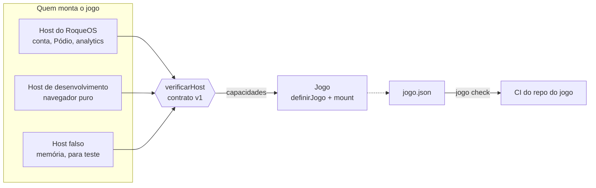
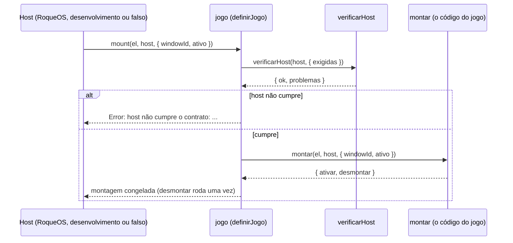
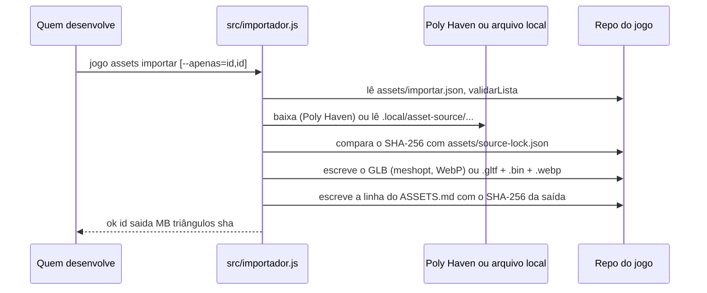
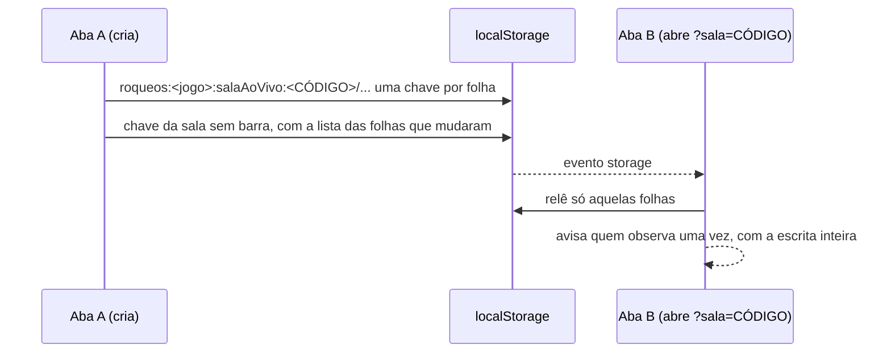

# Arquitetura

_[English](../ARCHITECTURE.md) | Português_

> **Para quem:** quem vai mudar o SDK, implementar um host ou portar um jogo e precisa saber como as peças se ligam antes de mexer.
> **O que tem aqui:** a ideia, o contexto, onde o código roda, cada componente com o arquivo dele, os fluxos principais em diagrama de sequência, os dados que atravessam uma fronteira, as decisões de design com data, e os limites conhecidos.
> **Onde ir para o resto:** todo comando, arquivo e formato está em [REFERENCIA.md](REFERENCIA.md); como um jogo ou um host usa cada capacidade, em [INTEGRACOES.md](INTEGRACOES.md); o que pode dar errado, em [QUANDO-QUEBRA.md](QUANDO-QUEBRA.md).

## Sumário

1. [A ideia em um parágrafo](#1-a-ideia-em-um-parágrafo)
2. [Contexto: quem usa e do que depende](#2-contexto-quem-usa-e-do-que-depende)
3. [Processos e onde rodam](#3-processos-e-onde-rodam)
4. [Componentes](#4-componentes)
5. [Os fluxos principais](#5-os-fluxos-principais)
6. [Dados e contratos](#6-dados-e-contratos)
7. [Segurança e segredos](#7-segurança-e-segredos)
8. [Decisões de design](#8-decisões-de-design)
9. [Limites conhecidos](#9-limites-conhecidos)
10. [Como os diagramas são feitos](#10-como-os-diagramas-são-feitos)

## 1. A ideia em um parágrafo

Um jogo é um objeto com `mount(el, host)`, criado por `definirJogo` ([`src/index.js`](../../src/index.js)). O `host` entrega capacidades (quem é o jogador, onde guardar o recorde, se o aparelho pede o perfil leve, como avisar alguma coisa na tela) e é só por elas que o jogo fala com o sistema. Três hosts implementam o mesmo contrato: o host do RoqueOS (que mora no `roqueos-front`, fechado, e não aqui), o host de desenvolvimento ([`src/host/desenvolvimento.js`](../../src/host/desenvolvimento.js)) e o host falso, para teste ([`src/host/falso.js`](../../src/host/falso.js)). O `mount` confere o host contra [`src/contrato.js`](../../src/contrato.js) antes de qualquer coisa rodar e recusa, com a lista inteira do que falta, o host que não cumpre. Em volta desse núcleo, o SDK traz o CLI `jogo` que todo repo de jogo roda no CI ([`bin/jogo.mjs`](../../bin/jogo.mjs)) e um conjunto de kits opcionais (modelos 3D, gráfico, painel de configurações, som, carga, pacote cifrado), para todo jogo da organização [roqueos-games](https://github.com/roqueos-games) fazer a mesma coisa do mesmo jeito.

## 2. Contexto: quem usa e do que depende

Os jogos moravam dentro do repositório do RoqueOS e importavam as stores dele direto. Em 25/09/2026 eles começaram a sair, cada um para um repo próprio, e vários são abertos para a comunidade. O jogo depende deste SDK, e não do RoqueOS, que é fechado ([README.pt-BR.md](../../README.pt-BR.md)).



| Depende de                                                                                       | Para quê                                                                                                                                     | O que acontece quando falta                                                                              |
| ------------------------------------------------------------------------------------------------ | -------------------------------------------------------------------------------------------------------------------------------------------- | -------------------------------------------------------------------------------------------------------- |
| O host do RoqueOS, no `roqueos-front` (fechado)                                                  | a implementação de verdade de cada capacidade: conta, Pódio, analytics, banco                                                                | o jogo continua rodando no host de desenvolvimento; nada neste repo prova que o host de verdade cumpre   |
| Node 22 ou mais novo, Yarn 1.22 ([`package.json`](../../package.json), [`.nvmrc`](../../.nvmrc)) | o CLI, os testes, o gate                                                                                                                     | o `yarn verificar` não roda                                                                              |
| Tags do GitHub (`vX.Y.Z`)                                                                        | como um jogo pina o SDK: `github:roqueos-games/jogo-sdk#vX.Y.Z`                                                                              | o jogo não consegue instalar uma versão fixa                                                             |
| O `three` do próprio jogo                                                                        | os kits de modelo, gráfico e som recebem os módulos do three do jogo; o SDK nunca importa o three ([`src/modelos.js`](../../src/modelos.js)) | os kits não servem; o contrato continua servindo                                                         |
| `@gltf-transform/*`, `meshoptimizer` e `sharp` do jogo                                           | `jogo assets importar` ([`src/importador.js`](../../src/importador.js))                                                                      | o comando para com a linha exata de `yarn add -D`                                                        |
| O `playwright` do jogo                                                                           | `jogo olho` ([`src/olho.js`](../../src/olho.js))                                                                                             | o comando para com a linha de instalação                                                                 |
| Blender                                                                                          | fontes FBX, OBJ e `.blend` no importador                                                                                                     | `modelo FBX/OBJ/.blend precisa do Blender: instale ou aponte BLENDER=`                                   |
| A API da Poly Haven                                                                              | as fontes `fonte.polyhaven` do importador                                                                                                    | o download falha depois de três tentativas; arquivo baixado à mão (`fonte.arquivo`) continua funcionando |

O SDK não tem dependência de runtime nenhuma ([`CLAUDE.md`](../../CLAUDE.md)); tudo em `devDependencies` existe para os testes do próprio SDK.

## 3. Processos e onde rodam

O SDK é uma biblioteca e um CLI. Não tem servidor, não tem daemon e não tem estado próprio.

| O quê                                           | Onde roda                                                                                                                                                                                                     | Quem sobe                                      |
| ----------------------------------------------- | ------------------------------------------------------------------------------------------------------------------------------------------------------------------------------------------------------------- | ---------------------------------------------- |
| A biblioteca (`definirJogo`, os hosts, os kits) | na página do jogo, no navegador; dentro do RoqueOS, na mesma origem do sistema                                                                                                                                | o bundle do próprio jogo                       |
| `jogo check`                                    | Node, no repo do jogo, na máquina de quem desenvolve e no CI do jogo                                                                                                                                          | `yarn jogo:check` ou `node bin/jogo.mjs check` |
| `jogo assets importar`                          | Node, no repo do jogo, na máquina de quem desenvolve (baixa e escreve arquivos)                                                                                                                               | quem desenvolve, à mão                         |
| `jogo olho`                                     | Node mais um Chromium sem janela do Playwright do jogo; sobe o `yarn dev` do jogo na porta 5199 quando não recebe `--url`                                                                                     | quem desenvolve, antes e depois de uma mudança |
| O gate do SDK                                   | GitHub Actions, workflow `verificar` ([`.github/workflows/ci.yml`](../../.github/workflows/ci.yml)), em todo push na `main` e todo pull request, inclusive de fork, com permissão só de leitura e sem segredo | o GitHub                                       |

## 4. Componentes

| Arquivo                                                            | Responsabilidade                                                                             | Quem depende dele                                                    |
| ------------------------------------------------------------------ | -------------------------------------------------------------------------------------------- | -------------------------------------------------------------------- |
| [`src/contrato.js`](../../src/contrato.js)                         | `VERSAO_DO_CONTRATO`, as capacidades com forma e motivo, `verificarHost`                     | tudo; o host do RoqueOS                                              |
| [`src/index.js`](../../src/index.js)                               | `definirJogo` e `mount`; reexporta o que o jogo importa                                      | todo jogo                                                            |
| [`src/manifesto.js`](../../src/manifesto.js)                       | o formato do `jogo.json`, `ETIQUETAS`, `LIMITE_DO_RESUMO`, `validarManifesto`                | `jogo check`; o RoqueOS, que gera o catálogo a partir dos manifestos |
| [`src/idiomas.js`](../../src/idiomas.js)                           | os dez idiomas, `normalizarIdioma`                                                           | manifesto, conferência dos textos, painel                            |
| [`src/e2e.js`](../../src/e2e.js)                                   | `emModoE2E` e `estadoE2E`, lidos de `window.__ROS_E2E__`                                     | jogos sob Playwright ou Cypress                                      |
| [`src/verificacao.js`](../../src/verificacao.js)                   | cada régua do `jogo check`                                                                   | o CLI; os mutantes                                                   |
| [`src/cli.js`](../../src/cli.js)                                   | as opções que cada comando aceita e o parse que recusa o resto                               | [`bin/jogo.mjs`](../../bin/jogo.mjs)                                 |
| [`src/importador.js`](../../src/importador.js)                     | `jogo assets importar`                                                                       | o CLI                                                                |
| [`src/olho.js`](../../src/olho.js)                                 | `jogo olho`                                                                                  | o CLI                                                                |
| [`src/modelos.js`](../../src/modelos.js)                           | perfil, renderizador, ambiente, carregador GLTF, `criarCenario`                              | jogos 3D                                                             |
| [`src/grafico.js`](../../src/grafico.js)                           | qualidades, efeitos, FOV, escolha guardada, cadeia de pós-processamento                      | jogos 3D                                                             |
| [`src/painel.js`](../../src/painel.js)                             | o painel de configurações (Gráfico e Som) em DOM puro, nos dez idiomas                       | jogos                                                                |
| [`src/som.js`](../../src/som.js)                                   | som gravado no espaço, laços, vozes contínuas, síntese de reserva                            | jogos                                                                |
| [`src/carga.js`](../../src/carga.js)                               | o progresso medido da carga, para a tela de entrada                                          | jogos                                                                |
| [`src/pacote.js`](../../src/pacote.js)                             | o `.pak` cifrado (AES-GCM): sela no Node, abre no navegador                                  | jogos com asset do Fab ou do Sonniss                                 |
| [`src/host/desenvolvimento.js`](../../src/host/desenvolvimento.js) | o host de desenvolvimento                                                                    | o `yarn dev` do jogo                                                 |
| [`src/host/falso.js`](../../src/host/falso.js)                     | o host falso, com `chamadas`, `disparar` e opção para cada falha                             | os testes do jogo                                                    |
| [`src/host/armazenamento.js`](../../src/host/armazenamento.js)     | o espaço de chaves `roqueos:<jogo>:<chave>` e um Storage em memória                          | os dois hosts                                                        |
| [`src/host/sala.js`](../../src/host/sala.js)                       | as regras de cadeira da sala de dois jogadores                                               | os dois hosts                                                        |
| [`src/host/salaAoVivo.js`](../../src/host/salaAoVivo.js)           | o motor da sala ao vivo, e as regras de caminho e de valor exportadas para o host do RoqueOS | os dois hosts; o RoqueOS                                             |
| [`src/host/progresso.js`](../../src/host/progresso.js)             | o jogo salvo, recusando o que o Firestore recusa                                             | os dois hosts                                                        |
| [`src/host/presenca.js`](../../src/host/presenca.js)               | as regras da presença e o motor em memória                                                   | os dois hosts; o RoqueOS                                             |
| [`src/host/ia.js`](../../src/host/ia.js)                           | confere a forma de um pedido de `ia.completar`                                               | o host falso                                                         |

## 5. Os fluxos principais

### 5.1 Montar um jogo



O `verificarHost` confere a versão do contrato, cada capacidade obrigatória, as opcionais que o jogo listou em `capacidades` e a forma de cada capacidade presente, e devolve todos os problemas de uma vez ([`src/contrato.js`](../../src/contrato.js)). Desmontar duas vezes acontece de verdade (a janela fecha e o componente em volta desmonta logo depois), então a segunda chamada não faz nada ([`src/index.js`](../../src/index.js)).

### 5.2 O `jogo check` no CI de um jogo

```mermaid
sequenceDiagram
  participant CI as CI do jogo
  participant B as bin/jogo.mjs
  participant P as src/cli.js
  participant V as src/verificacao.js
  CI->>B: jogo check [pasta] [--json]
  B->>P: lerArgumentos(argv)
  P-->>B: { comando, opcoes, posicionais } ou { erro } (sai 2)
  B->>V: verificarRepo(pasta, { sdk })
  V-->>B: [{ secao, problemas }]
  B-->>CI: uma linha por seção; sai 1 se houver problema, 0 se não
```

As seções são: scripts de instalação, manifesto, textos nos dez idiomas, origem dos assets, peso por perfil, Fab e Sonniss só cifrados e só em jogo fechado, e o jogo não falar com banco. Com `--sdk` só a primeira roda, porque o SDK não é jogo ([`src/verificacao.js`](../../src/verificacao.js)).

### 5.3 Importar um modelo de mercado



A lista é validada antes de qualquer download, um id de `--apenas` que não está na lista é recusado antes de escrever (0.5.1), e um original fixado que mudou na origem para o import com `a fonte fixada mudou` ([`src/importador.js`](../../src/importador.js)).

### 5.4 Uma sala ao vivo entre duas abas no host de desenvolvimento



Uma chave por folha existe porque duas abas publicando presença a 10 Hz fariam ler-modificar-gravar do mesmo JSON sem trava entre abas e uma apagaria a outra; o aviso único existe porque reagir a cada folha entregaria meio objeto ([`src/host/salaAoVivo.js`](../../src/host/salaAoVivo.js)).

## 6. Dados e contratos

**O host.** Um objeto com `versaoDoContrato: 1` e uma chave por capacidade. Função onde a forma diz `FN`, objeto com aquelas chaves nos outros casos ([`src/contrato.js`](../../src/contrato.js)). Obrigatórias: `identidade`, `avisar`, `audio`, `desempenho`, `metricas`, `placar`, `armazenamento`, `idioma`. Opcionais: `tela`, `teclado`, `ia`, `sala`, `salaAoVivo`, `progresso`, `presenca`, `retomada`.

**O manifesto `jogo.json`**, na raiz de cada jogo. O mínimo válido é a fixture de teste [`test/fixtures/jogo-ok/jogo.json`](../../test/fixtures/jogo-ok/jogo.json); encurtado aqui (o de verdade traz os dez idiomas em `nome` e `descricao`):

```json
{
  "id": "exemplo",
  "slug": "exemplo",
  "versaoDoContrato": 1,
  "nome": { "pt-BR": "Exemplo", "en-US": "Exemplo" },
  "seo": { "pt-BR": { "resumo": "...", "sobre": "...", "comoJogar": "..." } },
  "etiquetas": ["Puzzle", "Classic"],
  "capa": "public/capa.jpg",
  "icone": "public/icone.svg",
  "janela": { "largura": 520, "altura": 680, "minLargura": 340, "minAltura": 480 },
  "aceitaConvite": false,
  "entraNoPodio": true,
  "recorde": { "chave": "best", "maiorEMelhor": true },
  "capacidades": []
}
```

Cada campo está na [REFERENCIA.md](REFERENCIA.md#o-manifesto-jogojson).

**O registro de assets `ASSETS.md`**: uma tabela em Markdown, `caminho | licença | origem`, com uma quarta coluna opcional com o SHA-256 do arquivo, que o `jogo check` confere quando está lá ([`src/verificacao.js`](../../src/verificacao.js)).

**As chaves do armazenamento**: `roqueos:<jogo>:<chave>`, o mesmo formato que os jogos já usavam no `localStorage` do RoqueOS (o recorde do 2048 mora em `roqueos:game2048:best`), então tirar um jogo do front não zera o recorde de ninguém ([`src/host/armazenamento.js`](../../src/host/armazenamento.js)).

**O `.pak`**: a assinatura `JOGOPAK1\n`, 12 bytes de IV, e o texto cifrado em AES-GCM de `[u32 LE: tamanho do índice][índice JSON: {arquivos:[{nome,inicio,tamanho}]}][dados]` ([`src/pacote.js`](../../src/pacote.js)).

## 7. Segurança e segredos

Um jogo roda na mesma origem do RoqueOS. As capacidades organizam o código e não são fronteira de segurança: código na mesma origem lê o que a página lê ([`SECURITY.md`](../../SECURITY.md), [`src/contrato.js`](../../src/contrato.js)). O que protege quem usa o RoqueOS é a revisão do mantenedor em todo merge, o pin exato de versão, a proibição de script de instalação e um CI de pull request que não lê segredo nenhum. A capacidade `ia` nunca entrega a chave do provedor ao jogo. A chave do `.pak` mora no código do jogo, que mora em repositório privado; isso impede o download direto e a coleta por URL e não é DRM ([`src/pacote.js`](../../src/pacote.js)). O código da `retomada` vai no fragmento da URL, que não chega a servidor nem a log. O repo do SDK não guarda segredo nenhum. O quadro inteiro está em [MODELO-DE-AMEACAS.md](MODELO-DE-AMEACAS.md).

## 8. Decisões de design

| Decidido                                                                                                                 | Alternativa recusada                      | Por quê                                                                                                                                                                                               | Quando            |
| ------------------------------------------------------------------------------------------------------------------------ | ----------------------------------------- | ----------------------------------------------------------------------------------------------------------------------------------------------------------------------------------------------------- | ----------------- |
| O jogo recebe capacidades, não stores                                                                                    | entregar ao jogo as stores do RoqueOS     | um jogo com a store inteira pode abrir janela, ler credencial de servidor e mexer no desktop; um com `placar.salvar` só consegue salvar o próprio placar ([`src/contrato.js`](../../src/contrato.js)) | 0.1.0, 25/09/2026 |
| Capacidade nova e opcional é versão menor; mudar a forma é versão nova do contrato, e o host recusa jogo de outra versão | quebrar em runtime                        | recusar de saída dá para diagnosticar, quebrar em runtime não ([`src/contrato.js`](../../src/contrato.js))                                                                                            | 0.1.0, 25/09/2026 |
| A `ia` mudou de forma sem contrato v2, como exceção que não é precedente                                                 | subir para o contrato v2                  | medido em 26/09/2026: nenhum repo de jogo usava `host.ia`, e nenhum host tinha ([`CHANGELOG.md`](../../CHANGELOG.md))                                                                                 | 0.3.0, 26/09/2026 |
| O host de desenvolvimento não tem `ia`                                                                                   | fingir uma IA                             | o jogo que usa IA precisa funcionar sem ela, e é ali que se prova ([`src/host/desenvolvimento.js`](../../src/host/desenvolvimento.js))                                                                | 0.1.0, 25/09/2026 |
| Nenhuma dependência de runtime, e o SDK nunca importa o three                                                            | empacotar o three                         | cada jogo fixa o próprio three, e duas cópias na mesma página quebram o `instanceof` ([`src/modelos.js`](../../src/modelos.js))                                                                       | 0.4.0, 16/10/2026 |
| As ferramentas pesadas do importador são devDependencies do jogo                                                         | dependências do SDK                       | o RoqueOS instala o SDK e não pode arrastar o `sharp` junto ([`src/importador.js`](../../src/importador.js))                                                                                          | 0.4.0, 16/10/2026 |
| As réguas moram no SDK, chamadas por cada jogo                                                                           | uma cópia do check no CI de cada jogo     | vinte cópias de um check divergem em três meses; uma chamada não ([`src/verificacao.js`](../../src/verificacao.js))                                                                                   | 0.1.0, 25/09/2026 |
| O `jogo check` não tem nível de "aviso"                                                                                  | aviso que não reprova                     | problema que não reprova é problema que ninguém conserta ([`bin/jogo.mjs`](../../bin/jogo.mjs))                                                                                                       | sem data no repo  |
| O jogo nunca fala com banco; `firebase` é proibido no `src/`                                                             | deixar o jogo importar o Firebase         | jogo que importa o Firebase leva a configuração do projeto e as regras do banco para dentro dele, e quebra no dia em que o host muda de banco ([`src/verificacao.js`](../../src/verificacao.js))      | 0.3.0, 26/09/2026 |
| `progresso.carregar` responde `null` para "não há save" e rejeita para "não consegui ler"                                | `null` para os dois                       | confundir os dois grava um mundo vazio por cima de meses de construção ([`src/contrato.js`](../../src/contrato.js))                                                                                   | 0.3.0, 26/09/2026 |
| Teto de download de 30 MB fora de `alto/` e 120 MB no total                                                              | sem teto                                  | decisão do fundador de 16/10/2026 ([`src/verificacao.js`](../../src/verificacao.js))                                                                                                                  | 0.4.0, 16/10/2026 |
| Asset do Fab e do Sonniss só dentro de um `.pak` cifrado, só em jogo fechado; o Mixamo pode ir cru em jogo fechado       | arquivo cru em `public/`                  | EULA do Fab §4c e §5a; o Sonniss proíbe redistribuir as gravações ([`src/verificacao.js`](../../src/verificacao.js))                                                                                  | 0.4.0, 16/10/2026 |
| O CLI recusa toda opção que o comando não declara, e a ajuda ganha de tudo                                               | ignorar flag desconhecida                 | duas vezes um agente rodou `jogo assets importar --usage` e o importador reimportou o catálogo inteiro por cima dos arquivos ([`src/cli.js`](../../src/cli.js))                                       | 0.5.1, 18/10/2026 |
| A lista de etiquetas é fechada                                                                                           | etiqueta livre                            | o rótulo traduzido mora no RoqueOS, na chave `games.tag<Etiqueta>`, então etiqueta nova é mudança nos dois lados ([`src/manifesto.js`](../../src/manifesto.js))                                       | sem data no repo  |
| O texto de SEO existe só em pt-BR e en-US                                                                                | SEO traduzido por máquina nos dez idiomas | SEO é conteúdo escrito, não traduzido por máquina; os outros oito idiomas caem no en-US ([`src/manifesto.js`](../../src/manifesto.js))                                                                | sem data no repo  |

## 9. Limites conhecidos

- **Não é fronteira de segurança.** Mesma origem quer dizer que o jogo lê o que a página lê; a proteção é revisão e pin, dito no [SECURITY.md](../../SECURITY.md).
- **O host de verdade não está aqui.** O host do RoqueOS mora no `roqueos-front`. Nada neste repo prova que ele implementa o contrato v1 como está na 0.7.0; o falso e o de desenvolvimento implementam, e o [`test/contrato.test.js`](../../test/contrato.test.js) prova isso para eles.
- **O host de desenvolvimento não emula as regras do banco**, e o `localStorage` dele (cerca de 5 MB) serve para jogar e testar, não para semear um mundo grande ([README.pt-BR.md](../../README.pt-BR.md)). No host falso, a opção `recusar` faz o papel das regras.
- **O host de desenvolvimento não tem outro aparelho.** `retomada.link()` devolve `null` e `levarParaConta()` devolve `'indisponivel'` ([`src/host/desenvolvimento.js`](../../src/host/desenvolvimento.js)).
- **O `jogo check` soma o disco, não a rede.** O teto é o que pode ser baixado; o quadro de verdade quem mede é o `jogo olho` ([`src/verificacao.js`](../../src/verificacao.js)).
- **Os números do `jogo olho` são do navegador sem janela da máquina que rodou**, com o renderizador que o WebGL reportou gravado ao lado; iPhone de verdade continua sendo o iPhone ([`src/olho.js`](../../src/olho.js)). As flags do Chromium incluem `--use-angle=metal`, que mira o macOS; o comportamento em outros sistemas não foi medido.
- **`jogo check --sdk` só confere os scripts de instalação.** A qualidade do próprio SDK é o resto do `yarn verificar`.
- **O `.pak` não é DRM.** Quem lê o JavaScript do jogo chega à chave ([`src/pacote.js`](../../src/pacote.js)).
- **O diagrama do README, [`contrato.svg`](../contrato.svg), é um SVG estático com rótulos em português e sem gerador no repo.** Os diagramas deste documento são mermaid.
- **O gancho de pre-push não é versionado aqui.** O [`CLAUDE.md`](../../CLAUDE.md) diz que o gate é o mesmo do CI e do pre-push; o gancho vem do ferramental da família na máquina do mantenedor.

## 10. Como os diagramas são feitos

Os diagramas deste documento são mermaid dentro do Markdown, desenhados pelo GitHub; a fonte é o texto, e o par em inglês traduz os rótulos. A imagem no topo do README, [`docs/contrato.svg`](../contrato.svg), é um SVG escrito à mão e versionado como está. A lista dos diagramas e onde cada um é explicado está no [INDEX.md](INDEX.md#diagramas).
